<p align="center">
  
</p>

<h1 align="center">Mawaqit Prayer Times — KDE Plasma 6 Widget</h1>

A Plasma 6 plasmoid that shows prayer times for **your** mosque, using the
exact timetable your mosque publishes on [mawaqit.net](https://mawaqit.net)
— not astronomical approximations.

## Features

- **Panel-friendly compact view**: next prayer + live countdown in a horizontal
  panel; in a vertical panel, the next prayer's own icon with the minutes left
  underneath. Click either to expand the full table
- **Two display modes**: full daily timetable, or only the next prayer
- **Icons instead of names**: the horizontal strip can swap each prayer name
  for its own glyph — first light, sunrise, zenith, shadow, sunset, night —
  which frees up a lot of panel width. The settings show the six icons with
  their names so nothing has to be guessed
- **Six layouts for the desktop widget and the popup**: Classic, Sundial,
  Cards, Horizon (over al-Masjid al-Aqsa or al-Masjid an-Nabawi), Kaaba
  and Qalam — see the [Gallery](#gallery). Switching layout never resizes
  the widget. The panel itself keeps its compact view
- **Hijri date**: shown in the popup, and optionally in the panel as either
  the spelled-out form (2 ربيع الثاني 1448 هـ) or plain digits (02/04/1448)
- **Appearance customization**: pick a custom font, scale the desktop widget
  or panel popup (panel text follows the panel's thickness), override the
  text and next-prayer accent colors, and give the widget a custom background
  with adjustable color, opacity, and corner radius — every option is opt-in
  and falls back to your Plasma theme. Colors and background apply to the
  Classic and Cards layouts; the Sundial, Horizon, Kaaba and Qalam paint
  their own. "Show the next prayer in bold" needs a
  font that has a bold style; with fonts that don't, it has no effect
- **Set up from your mosque's link**: paste the link the Mawaqit app shares
  for your mosque, or its mawaqit.net address, in the settings (see
  [Choosing your mosque](#choosing-your-mosque))
- **Offline-first**: the entire year's calendar is cached locally after a
  single download — the widget keeps working with no network, and
  re-downloads only every few days to pick up schedule corrections
- **Localized prayer names**: English, العربية, Français, or follow the
  system language
- 12/24-hour format, optional sunrise (Shuruq) row

## Gallery

All shown in Arabic with a dark Plasma theme, at 18:20 with Isha next.

### Desktop widget and popup layouts

<table>
  <tr>
    <td align="center">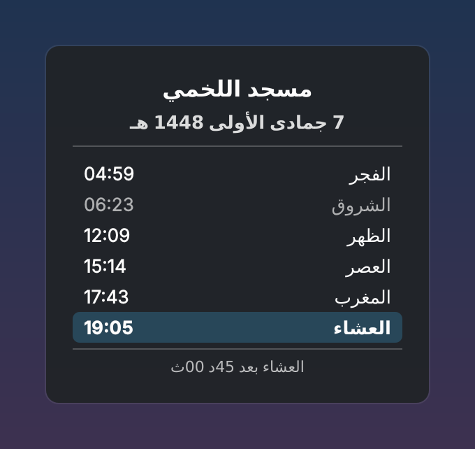<br>Classic</td>
    <td align="center">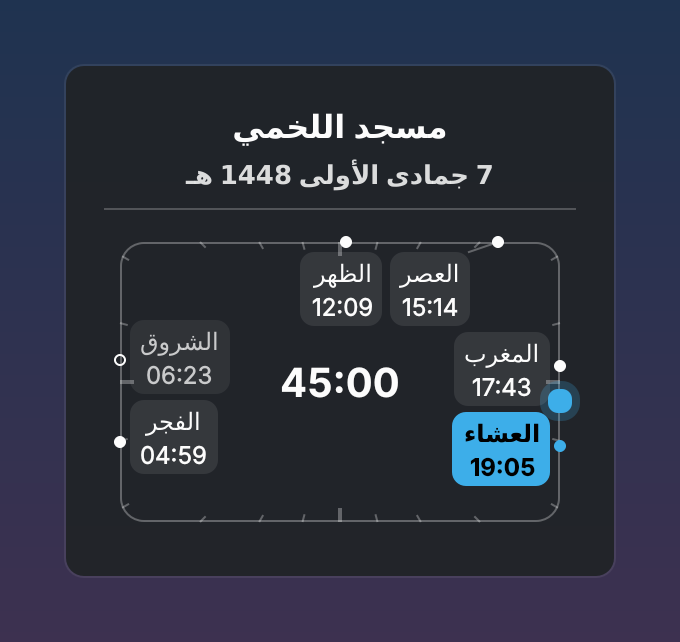<br>Sundial</td>
    <td align="center">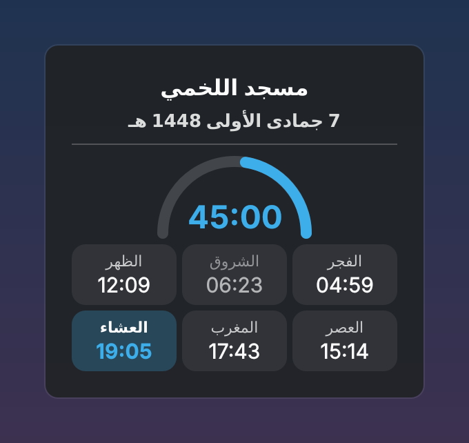<br>Cards</td>
    <td align="center">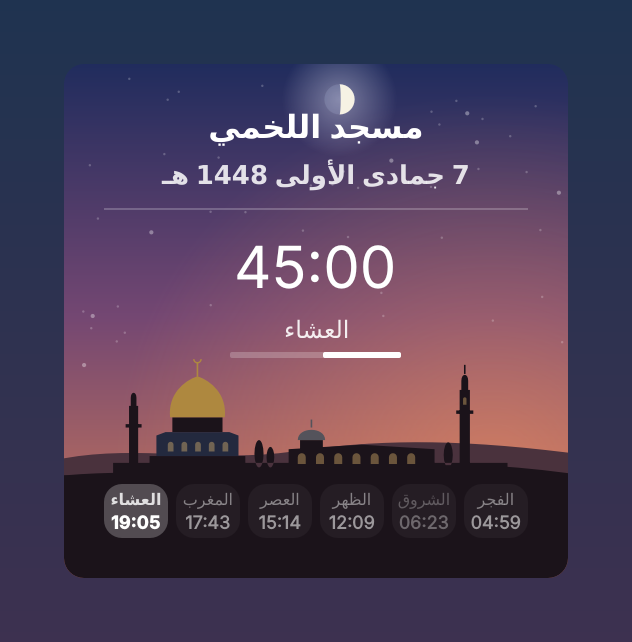<br>Horizon, al-Aqsa Mosque</td>
  </tr>
  <tr>
    <td align="center">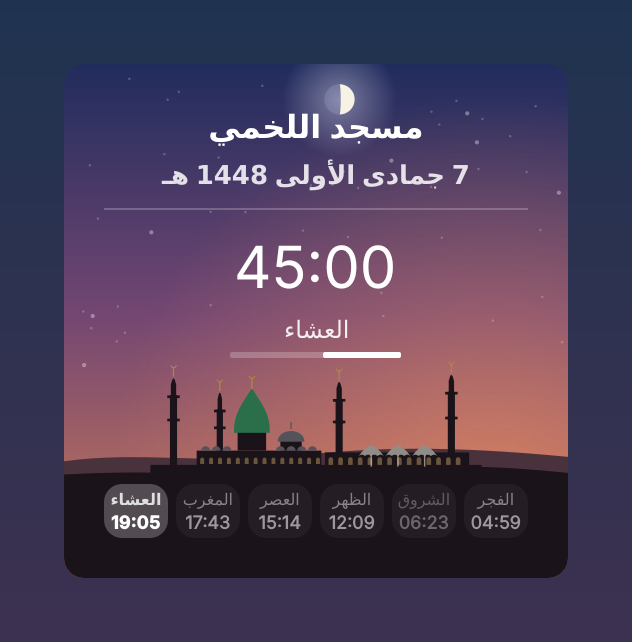<br>Horizon, Prophet's Mosque</td>
    <td align="center">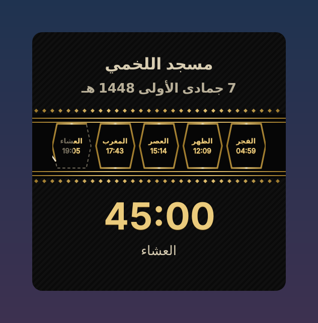<br>Kaaba</td>
    <td align="center">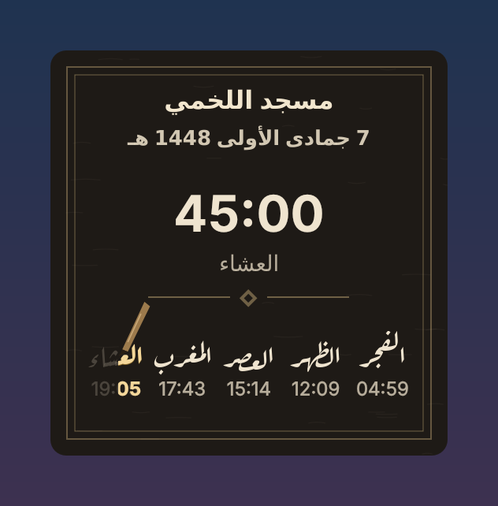<br>Qalam</td>
  </tr>
</table>

### Panel

All prayer times, with names, with icons, and with icons and the hijri date as digits:

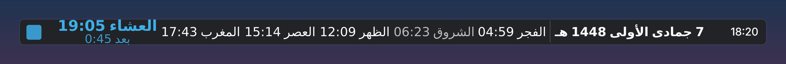<br>
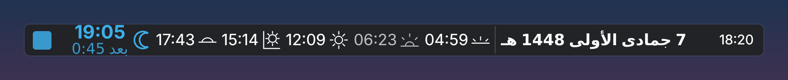<br>
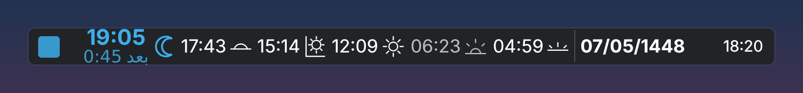

Next prayer only, with its name and with its icon:

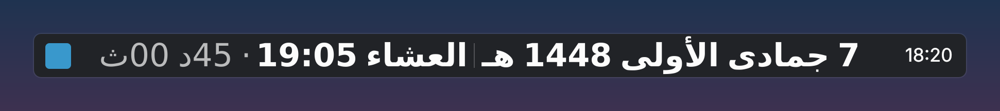<br>
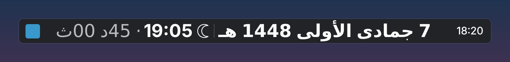

Vertical panel, the next prayer's icon and the minutes left:

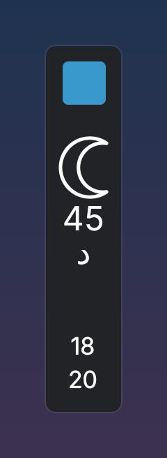

## How it works

Each mosque page on mawaqit.net embeds a `confData` JSON object containing
the full annual prayer calendar. The widget downloads your mosque's page
once, extracts that object with a string-aware brace-balanced parser, and
caches the calendar in the widget configuration. Everything else — today's
times, the next prayer, the countdown — is computed locally.

The Hijri date is computed with the same arithmetic calendar Mawaqit itself
uses, and the `hijriAdjustment` your mosque publishes is applied on top of
it. That matters because your mosque's admin calibrates that adjustment
against what Mawaqit displays — so the widget shows the date on your
mosque's own screens rather than a calendar that quietly disagrees with it.

No account, no API key, no third-party server. Each installation talks
directly to mawaqit.net roughly once a week, and once a day around the end
of each Hijri month, so a new adjustment after the moon sighting shows up
the next day.

### If the Hijri date is off by a day

The widget cannot know when a new month begins in your community — it
shows exactly what your mosque publishes. If the date is wrong, it is wrong
on Mawaqit too, and only **your mosque's administrators** can fix it: ask
them to update the Hijri date adjustment in their Mawaqit settings. The
widget picks up the change on its next refresh, or right away with
right-click → **Refresh prayer times**.

## Choosing your mosque

1. In the Mawaqit app, search for your mosque, open it and tap **Share**.
2. The shared message contains a link like `https://mawaqit.net/ar/id/12345`.
   Copy **only that link**, not the whole message.
3. Open the widget's settings and paste it in **Mosque link**.

The address of the mosque's page on mawaqit.net (for example
`https://mawaqit.net/fr/your-mosque`) works too, and so does its last part,
the mosque's slug. The widget checks the link right away and shows the
mosque's name, so you know you picked the right one.

The settings used to search Mawaqit for mosques and detect your location.
Since 6 October 2026 Mawaqit's search API requires an account token, and
Mawaqit doesn't allow its API to be used outside its own applications, so
the widget no longer searches; it only reads your mosque's public page.

## Installation

### KDE Store (Get New Widgets)

Install straight from Plasma — no terminal needed: right-click your panel or
desktop → **Add Widgets…** → **Get New Widgets…** → **Download New Plasma
Widgets**, then search for *Mawaqit Prayer Times* and install.

Or open the store page directly:
[store.kde.org](https://store.kde.org/p/2365203) ·
[opendesktop.org](https://www.opendesktop.org/p/2365203)

### Arch Linux

Install [`plasma6-applets-mawaqit-prayer-times`](https://aur.archlinux.org/packages/plasma6-applets-mawaqit-prayer-times)
from the AUR with your preferred helper:

```sh
yay -S plasma6-applets-mawaqit-prayer-times
```

```sh
paru -S plasma6-applets-mawaqit-prayer-times
```

### From source

You need `git` and `qsb` from Qt Shader Tools (`qt6-shadertools` on Arch,
`qt6-shader-baker` on Debian/Ubuntu). `build-shaders.sh` compiles the widget's
shaders; without them the widget still works, but the Horizon layout's header
keeps a plain color instead of being lit by the sun and the moon.

```sh
git clone https://github.com/medaminezghal/plasma6-applets-mawaqit-prayer-times.git
cd plasma6-applets-mawaqit-prayer-times
./build-shaders.sh
kpackagetool6 --type Plasma/Applet --install package
```

To upgrade later, from the same folder:

```sh
git pull
./build-shaders.sh
kpackagetool6 --type Plasma/Applet --upgrade package
```

## Privacy

- At runtime the widget contacts only `mawaqit.net`.
- The **General** settings page asks the KDE Store (`api.kde-look.org`) for
  the latest version, only while that page is open.

## License

GPL-3.0-or-later
